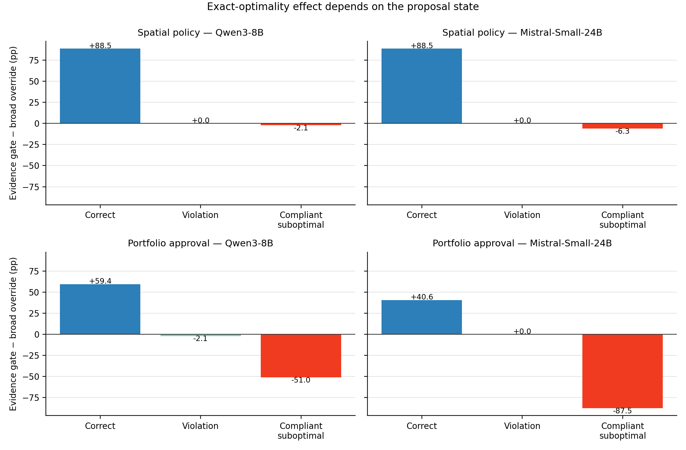

# Institutional Representation Research

*How institutions translate represented objectives into binding collective decisions.*

[](https://github.com/tofuadmiral/institutional-representation-abm/actions/workflows/ci.yml)
[](https://www.python.org/downloads/)
[](LICENSE)
[](https://arxiv.org/abs/2608.24554)
[](https://doi.org/10.5281/zenodo.22119500)

This repository contains two completed studies and an exploratory third implementation. Paper 1 uses a
rule-based agent-based model of democratic legislative institutions. Paper 2
uses open-weight language models in a proposer-reviewer decision pipeline. The
shared question is how institutional rules shape the translation from represented
preferences or duties to final outcomes.

## Papers

### Paper 1 — published preprint and frozen release

**Why fragmented parliaments stop passing legislation: Opposition discipline
and representation across four democratic institutions**

- [arXiv:2608.24554](https://arxiv.org/abs/2608.24554)
- [Manuscript PDF](paper/main.pdf)
- [Conference poster](paper/poster.pdf)
- [Interactive model](https://institutional-representation-abm.streamlit.app/)
- Canonical reproducibility snapshot: [`v1.0.2`](https://github.com/tofuadmiral/institutional-representation-abm/releases/tag/v1.0.2)
- Archived software DOI: [10.5281/zenodo.22119501](https://doi.org/10.5281/zenodo.22119501)

Paper 1 compares parliamentary, presidential/republican,
premier-presidential, and president-parliamentary systems. Across simulation,
sensitivity analysis, and mechanism ablations, it finds that fragmentation
alone does not stop legislation: collapse requires cohesive opposition
discipline. It also identifies a passage-representation tradeoff between
legislative throughput and the distance of enacted policy from constituency
preferences.

The root `CITATION.cff` and `.zenodo.json` describe the frozen Paper 1 software
release. Later commits on `main` include Paper 2 and are not the tree analyzed by
Paper 1.

### Paper 2 — complete manuscript

**Who May Overrule the Agent? Evidence-Gated Authority in LLM Review
Institutions**

- [Manuscript PDF](paper2/main.pdf)
- [Paper 2 source and reproduction guide](paper2/README.md)
- [Frozen processed results and raw model outputs](paper2/data/README.md)

Paper 2 studies a two-agent decision institution. An upstream language-model
agent proposes a binding action, and a second language-model agent reviews it.
The primary treatment changes only the reviewer's jurisdiction:

- **Broad override:** any parseable recommendation can replace the proposal.
- **Evidence gate:** replacement requires a mechanically valid record of a
  binding-constraint violation and a compliant repair.

Across Qwen3-8B and Mistral-Small-24B, the gate protects correct and compliant
proposals while retaining most repairs of violations. It also prevents reviewers
from improving compliant but suboptimal proposals. The resulting finding is a
correction-corruption frontier: the exact-welfare winner depends on the upstream
mix of proposal states and the reviewer's state-conditional competence. A
prospectively frozen validation also gives the reviewer explicit retain,
replace, and escalate actions. This removes correct-proposal corruption for
Qwen but not for Mistral, while making Qwen decline every welfare-only repair.
Reviewer interface and binding jurisdiction are therefore separate,
interacting institutional choices.

<p align="center">
  
</p>

### Paper 3 — exploratory implementation, not a manuscript

**Current checkpoint (15 October): accountability discovery remains exploratory.**
The next implementation studies whether binding versus advisory accountability,
scored by majority approval versus summed constituent utility, changes how seven
representatives bargain for 63 synthetic citizens over two terms. The previous
institutional run stopped on upstream rate limits before completing a two-term
episode; it provides no complete accountability comparison. A fresh recovery
implementation is undergoing offline end-to-end verification and has not launched
model calls. Software checks and scripted responses are not research findings.
Paper 1's release and Paper 2's results are unchanged.

This is a work-in-progress code checkpoint, not a reproducibility release. Some
exploratory evidence archives referenced below are retained locally rather than
bundled in Git; see the [archive availability note](paper3/data/README.md).
[Current implementation and verification status](paper3/README.md).

The following are historical checkpoints, not the current launch or budget state.

**Historical (4 October): conditional-score-ledger qualification passed 24/24 checks.**
Four role/score reports, eight counterfactual ballot questions and twelve legal
actions; 25 physical requests including one approved answerless rate-limit
reissue. Frozen-source audit and actual isolated archive replay match exactly.
This is limited technical readiness, not an accountability or publication result.
Conservative cumulative accounting is $6.608958611 of the approved total $12,
including every pending/uncertified reservation. Follow-up paused; no institutional
successor launched. Earlier failed qualifications and pilots remain unchanged.
[Protocol and technical status](paper3/README.md).

**Historical qualification terminal (4 October reporting): gate failed.**
21physical requests:18logical passes(11facts/7legalactions), one genuine payoff-
report error, one rate-limit stop and four unstarted tasks. One bounded answerless
retry succeeded; a second429stopped the run. This is not just formatting or
infrastructure: the substantive error also fails the frozen all24gate. All54sources
unchanged; audit/clean archive/actual fresh offline replay match. No accountability
finding or institutional successor launched. Stage$0.17086064; cumulative
$6.378452451includes all reservations, leaving$5.621547549under approvedTOTAL$12.
Follow-up PAUSED. [Details](paper3/README.md).

**Historical qualification terminal: upstream rate-limit stop (3 October).**
Six factual tasks passed; request7received an answerless provider429. The frozen
no-retry rule stopped the gate, leaving17of24tasks unstarted, including every
strategic action task. No inferred answer/retry/restart or institutional launch.
All51frozen files unchanged; production audit, credential-scanned archive and
actual fresh isolated offline replay match. Qualification NOT met, no accountability
finding. Conservative stage$0.05177908; cumulative$6.207591811/10 includes all
pending/uncertified reservations. Follow-up PAUSED. [Details](paper3/README.md).

**Accountability pilot (3 October UTC): terminal output-interface stop.**
The billing-separated pilot completed two of16assigned episodes, then stopped
when the model wrote a function name plus JSON rather than an accepted response
form.73logical/75physical calls; no inferred ballot, content repair or restart.
All77frozen files unchanged; production audit and actual fresh-extracted offline
archive replay match exactly. Scientific screen **incomplete**, not an
accountability finding or a null. Block1 blocked and follow-up paused. Conservative
accounting $6.155812731/10 includes every pending/uncertified reservation;
budget remains but technical completion failed. [Details/archive](paper3/README.md).

**Previous accountability pilot (2 October): terminal billing-certification stop.**
The public-text-prefix pilot completed one of16assigned episodes, then stopped:
the next response finished, but all four billing-receipt lookups returned404.
33logical/34physical requests; no inference retry or retrospective acceptance.
All72 frozen sources unchanged; production audit and actual fresh-extracted
offline archive replay match. Scientific screen **incomplete**, not a null or
accountability finding; no accepted message needed clipping. Block1 blocked,
follow-up paused. Cumulative conservative accounting $5.527274391 of $10 retains
all pending/uncertified reservations. [Details/archive](paper3/README.md).
Earlier failures stay immutable; no successor launched.

**Previous accountability pilot (2 October): terminal interface stop.**
One complete two-term episode passed exact replay; the next draft contained a
legal policy in valid tool output but a 143-character public message against the
frozen 128-character bound. The run stopped without content repair: 31 logical
actions, 32 physical requests, one completed episode among 16 assignments.
The scientific screen is **incomplete**, not evidence for or against
accountability. All 70 frozen sources are unchanged; production audit and actual
fresh-extracted isolated archive replay agree. The conditional second block is
blocked and the finished run's follow-up is paused. Cumulative conservative
accounting is $5.423564031 of $10, retaining all unresolved reservations.
No accountability finding yet; operational details and archive are in
[Paper 3's guide](paper3/README.md).

**Previous engineering interruption (2 October):** the separately frozen
rate-limit-recovery runner failed during startup on an incorrect live transport
binding, before any model request or new reservation. All 70 sources and all 16
assignments remain unchanged. There is no terminal controller record, so full
production audit/replay is unavailable; no restart or second block. The 92
offline checks covered injected transport, not the missing default binding.
Conservative accounting remains $5.334021871 of $10. The follow-up remains
paused; a separate corrected adapter must test that default path before calls.

**Previous bargaining pilot (2 October): terminal upstream rate limit.**
Twelve valid decisions were followed by a pre-answer AtlasCloud HTTP429.
No term/episode completed; all 16 assignments remain and the scientific screen
is **incomplete**, not a behavioral null or a publication result. No retry,
restart or second block. All 65 frozen sources are unchanged; exact production
audit and actual fresh-extracted network-disabled replay agree. Conservative
accounting is $5.334021871 of $10, including unresolved reservations.
The 18/18 V2 qualification remains a limited interface pass. The finished run's
follow-up is paused; a transport-policy successor is a proposal, not a live run.
The earlier failed runs remain unchanged. See the
[implementation guide](paper3/README.md) and [archive guide](paper3/data/README.md).

**Output-contract preparation (2 October):** a new prospective parser accepts
one actual function call or one exact structured final answer, with no repairs
or conflicting decisions.182 offline tests and network-disabled isolated
controller checks pass; all earlier freezes remain unchanged. No new model
calls, qualification or institutional result. See the
[implementation guide](paper3/README.md) for the63-source engineering freeze.

**Latest bargaining stage (1 October): terminal output-channel failure.**
The first serial AtlasCloud block stopped after11 requests:10 actual tool actions,
then a complete/native/billing-valid response returned its vote as ordinary text,
not a function call. Frozen strict channel checks failed; no retry or repair.
Zero terms/episodes completed. All16 assignments and missingness bounds remain;
scientific verdict is **incomplete**, not an accountability no-go or paper result.
60 frozen sources unchanged; exact production audit and actual fresh-extracted
network-disabled Python `-I -S` replay agree. Stage certified cost$0.02971850,
cumulative$5.248862691; four pending/30 older uncertified and all prior entries
preserved. Follow-up PAUSED; no restart or batch1. See the
[implementation](paper3/README.md) and [archive](paper3/data/README.md) guides.

**Prior qualification (1 October):** all18 fresh explicit-presence checks
passed under an unchanged51-source freeze:12 exact facts/six legal actions,
complete native reasoning, accepted tools and certified billing. No retries
or repairs; no institutional finding. The terminal-report encoding changed,
not payoffs, histories or actions. Fresh isolated offline archive replay agrees
exactly. Stage charge$0.04357160, cumulative$5.219144191 including preserved
reservations. Follow-up PAUSED; no automatic successor. See the
[implementation guide](paper3/README.md).

**Prior check (1 October):** portable nullable-schema qualification stopped
after one complete native/tool/billing-valid response: the returned identity
and score matched, but `successor_score` was the string `"null"`, not JSON null.
The frozen type check failed; no repair/retry or institutional episode occurred.
All18 assignments retained,17 unstarted. This is an output-interface failure,
not evidence of faulty institutional reasoning. Stage accounting$0.00215488,
cumulative$5.175572591 including old reservations. Follow-up PAUSED; no paid
successor authorized. The previous upstream schema error remains archived.
See the
[implementation guide](paper3/README.md).

**Prior checkpoint (1 October):** the serial-only accountability pilot is closed
under its unchanged 58-source freeze, protocol
`2aa999f9ab46f2fbd8604dfcd633388c7cb9a67114a2f0e60d83cf8e46d537c4`.
Nine physical requests yielded seven native/tool-valid, certified responses.
One pre-answer HTTP429 received its permitted identical reissue successfully;
a later partial stream ended without a valid final action or billing receipt
and correctly stopped the run. Its underlying cause is unknown. No first term
or episode completed; all 16 assignments and failures remain retained. The
scientific screen is `incomplete`, not a null or institutional finding. Exact
fresh-extracted offline replay agrees with the audit. Stage accounting is
$0.04107466, cumulative $5.169434731 including pending/uncertified reservations.
The follow-up is PAUSED; no restart, second stage or paid successor is approved.
See [Paper 3's implementation and archive guides](paper3/README.md).

The following qualification and terminal checkpoints are historical:

A subsequent retrospective-accountability qualification attempt stopped after
two certified reasoning calls: its second factual counterfactual was incorrect.
No institutional episodes started. The failed gate and exact portable replay
are retained; it provides no evidence for or against an accountability effect.
A fresh gate with explicit data axes/ballot semantics also failed its second
counterfactual case; it too is archived, with no institutional episodes run.
A separately frozen DeepSeek V3.2/DeepInfra automatic-tool qualification
passed twelve factual reports and two legal actions, then stopped on an
incomplete, uncertified stream. Three cases were not started. Exact audit and
fresh-extracted replay preserve `qualification_failed`; no bargaining ran.
Reused cases are not held-out evidence, and qualification is not an
institutional result. The failure's cause is unknown, not an observed
accountability effect.
A fresh transport-aware qualification stopped after three certified calls:
two factual reports passed, but the terminal incumbent score was23 instead
of20. Saved reasoning uses a different policy's payoff column; the exact
sum was already disclosed. No retry was eligible or used. All eighteen tasks
and36 attempt slots remain in the audited, exact-replay archive. No institution
ran, and no paid successor is running. This is an instrument failure, not an
accountability result; any revised representation needs fresh qualification.
A final fresh qualification on common policy-keyed payoff cards passed all
twelve exact factual checks and six legal-action checks, with native reasoning,
certified charges and no retries. Its42 frozen sources and178 offline tests,
independent audit and exact portable replay are retained. This qualifies the
instrument on those tasks, not an accountability effect or randomized interface
improvement. The full bargaining pilot now has a separate fifty-source freeze
and194 passing retrospective tests. All sixteen episodes are assigned before
responses; the first budget batch stopped on request14: upstream HTTP429,
with no response content/generation ID. Its13 prior actions were native/tool-
valid and certified. No term completed, no parallel workers or second batch
started. The audited archive and fresh isolated replay retain all16 assignments
and classify the screen as `incomplete`, not a scientific null. No retries or
repairs were made. That closed run produced no completed institutional outcome;
see [Paper3 implementation](paper3/README.md) for the pinned protocol.

A transport-tolerant successor approved on 1 October has also closed under a
56-source freeze, protocol
`574829e49c216b242c77ae30192197603faea51e3662f1728255be52e2432b9d`.
The serial two-term episode completed, but a subsequent pre-answer upstream
HTTP429 also defeated its one permitted identical retry. The frozen safety rule
stopped new admissions. Of 118 physical requests, 109 were native/tool-valid
and billing-certified; nine failed reservations remain retained. Eight approved
reissue events occurred. All 16 assignments remain: one complete episode,
four interrupted episodes, and eleven unstarted episodes across both batches.
Five first-term outcomes are available, but the prespecified scientific screen
is `incomplete`; missingness bounds permit both effect directions. This is not
an accountability finding or scientific null. Independent audit and an actual
fresh-extracted, network-disabled `-I -S` replay exactly agree; see the
[terminal archive](paper3/data/README.md). Stage conservative accounting is
$0.37310728, cumulative $5.128360071, including every retained reservation.
At that closed checkpoint no model process or paid successor was running,
and the follow-up was paused.
All frozen sources and older archives are unchanged. No new qualification
calls, content repairs, case replacements or second-batch launch occurred.
The following describes the historical offline integration checkpoint:
Sixty-three new recovery/preflight/coordinator/full-institution checks pass,
including fabricated two-term bargaining, successor handover, complete and
partial archives, concurrent failures and actual fresh-extracted `-I -S`
replay. All seven closed source/evidence sets remain unchanged. These are
engineering checks, not model findings; the candidate has no paid-launch CLI.
At that checkpoint, human transport-policy approval and a reviewed live source
freeze were still required; its fabricated checks used no model spending.

A separately frozen release-right go/no-go test completed all 432 valid actions
on six fresh, opportunity-conditioned games across three coalition topologies.
Its prespecified verdict is `no_go_agreements_rare`: only one of twelve episodes
activated an agreement, none of the three pivotal pairs changed exposed-contract
activation, and no active control agreement was stable across arms. Exact audit
and fresh-extracted offline replay agree. This closes the release-right exploration
without establishing that release rights never matter. No Paper 3 publication
result exists; protocol, costs and archive are in [Paper 3's guide](paper3/README.md).

[Paper 3 instrumentation and experimental checks](paper3/README.md) cover seven-agent
negotiation, agenda and amendment rights, ratification, and commitment-state diagnostics,
using local open-weight models and separately frozen hosted-model pilots.
An earlier exploratory extension tested endogenous coalition agreements,
enforceability, and whether nonmembers have approval rights, retaining each
constituent's outcomes separately from mechanically enforced compliance.
The first complete Qwen coalition pilot has 270 decisions across nine episodes,
with audited, portable replay. A later structural-jurisdiction pilot recorded 664
calls across 24 assignments, but only 22 episodes completed; its prespecified
feasibility and primary discovery screens failed. Selected proposal and voting
paths differed, but no ballot was changed by enforcement in either pilot.
These pilots have not established a publication-quality institutional effect.
A newer constituent-level pilot retained 63 individual outcomes per constructed
profile across three authority rules: 20 of 21 episodes completed, while one
failed on a response-stream interruption. Its full feasibility gate is false
and its pre-vote screen formally indeterminate. Complete cases show proposal
and unforced-vote differences, but no enforcement-induced ballot changes;
similar welfare shifts in non-exchange controls limit mechanism specificity.
A subsequent frozen repeatability calibration held two exchange payoff tables
fixed across three paired seed blocks. Nineteen of 21 assigned episodes
completed; two invalid openings remain failed. Its feasibility and prewritten
stability triage failed: the institutional welfare contrasts changed direction
or vanished, and same-arm variation was substantial. The audit and portable
archive replay are documented in [Paper 3's data guide](paper3/data/README.md).
This rules out scaling that contract-specific exploratory lead as it stands;
it is not a general null result about institutions.
A separate citizen-ratification pilot then compared advisory and binding
district referendums around a seven-representative chamber. Three completed
outsider-harm comparisons changed the agents' final proposals from an
insider-favored policy to a ratifiable compromise, but one no-veto control
changed too, and two binding episodes failed the frozen action-length
limit. The pilot's prewritten feasibility and behavioral screens both failed;
the single constructed harm table is not independent replication or a
paper result. See [Paper 3's data guide](paper3/data/README.md) for its
audited outcomes and portable archive.
A subsequent distribution-matched pilot held every district's aggregate
preferences constant while moving one outsider district from 5/9 to 4/9
citizen approval. Across two constructed payoff games and repeated seeds,
the agents changed their final proposal only when that outsider veto was
binding; all 16 episodes completed and the prospectively written discovery
screen passed. This is a clean selected-case behavioral result, not yet a
publication-quality claim: the games share a simple template, the response
to a known veto is expected, and only one model was tested. Its frozen
audit and portable archive are in [Paper 3's data guide](paper3/data/README.md).
A later private-information extension crossed voluntary representative
disclosure with a controller-certified referendum-count bulletin on two
new constructed games. All 24 episodes and 384 decisions completed; the
frozen audit and portable replay pass. The binding outsider-veto changed
agents' final proposals under both information rules, but certification
did not improve final outcomes over voluntary disclosure in these selected
cases. This is informative mechanism discovery, not a population estimate
or a publishable Paper 3 result; the chamber compromise remained easy to
pass, and one model was tested. Its complete records and limitations are
in [Paper 3's data guide](paper3/data/README.md).
Two frozen structured-output gates were curtailed by upstream rate limits;
one returned a valid action, far short of the prespecified feasibility bar.
Neither was retried or used to launch a larger pilot.
An independently frozen Qwen3.5/Darkbloom strict-schema gate subsequently
returned ten valid structured answers but failed two institutional-state
checks; its conditional exchange pilot was not launched. A distinct,
prospectively frozen route-jurisdiction gate also failed after three recorded
calls, including an ambiguous review-binding field and an output-length stop;
its conditional institutional pilot was not launched. A harder six-game
ratification/disclosure extension completed 46 of 54 assignments, so its
prespecified comparison is not identified. A separate seven-representative
coalition/election pilot completed all 16 selected episodes, but its binding
arms formed different early coalitions; a subsequent fixed-opportunity
focal-response diagnostic also failed its prewritten all-case screen.
Neither supports an electoral-credit effect, and those frozen runs were not
repaired or selectively rescored. A separately clarified Qwen route-
jurisdiction gate also failed its strict 12-case prerequisite after four
answers (three exact); the conditional route pilot was not launched.
A subsequent 24-episode, 408-decision outsider-amendment versus citizen-veto
pilot completed with an exact audit and portable replay. Its prespecified
amendment-action lead failed (two of four required three aligned switches;
only five of eight required six closed final proposals retained the insider
favorite). The veto arm's agents chose the ratifiable compromise in all
eight selected blocks, a descriptive response to a known veto rather than
a rescued primary result. No Paper 3 finding has passed publication-quality
validation. The complete negative and descriptive records are in
[Paper 3's data guide](paper3/data/README.md).
The later fresh-population ratification discovery was interrupted after
177 of 576 intended calls, with no terminal audit and one transport-failed
episode. Its strict all-episode feasibility condition cannot pass; the
prepared holdout validation was not launched. Four unresolved call
reservations remain conservatively counted. This is not a new empirical
finding; [Paper 3's technical guide](paper3/README.md) records the status.
The next design decision is recorded
in the separate Obsidian research notes.
A later separately frozen common-transcript sponsorship pilot
completed all 12 paired profiles and 396 actions, but its prewritten
constituent-outcome lead failed (3 public-benefit, 1 public-harm, 4 unchanged
split pairs; 4 stable controls). Its exact audit and portable replay are in
[Paper 3's data guide](paper3/data/README.md); it is not a paper result.
Most recently, a constituent-release branching pilot passed its serial
interface check but stopped after one response reached the output-length cap.
Only one of 20 assigned episodes completed and no game has both institutional
arms complete. Its exact audit and portable replay preserve the 97 paid calls
and classify the comparison as incomplete, not a behavioral null or finding;
see [Paper 3's data guide](paper3/data/README.md).
Their preserved outputs include negative results and instrument-validity checks;
they are not part of the evidence for Papers 1 or 2.

## Quick start

Create the shared analysis environment and run the full test suite:

```bash
python3 -m venv .venv
source .venv/bin/activate
pip install -r requirements.txt
pytest tests/ -v
```

### Reproduce Paper 1

For exact Paper 1 reproduction, check out tag `v1.0.2`. On the current tree,
the original commands remain available:

```bash
# Four institutions × four scenarios, N=200 seeds
python -m experiments.multiseed_comparison --scenarios all --seeds 200 --output results/main/

# Hung-parliament decomposition
python -m experiments.hung_parliament --seeds 200 --output results/phase_h/

# Sensitivity analysis and mechanism ablations
python -m experiments.sensitivity --output results/main/
python -m experiments.ablation --scenarios baseline fragmented polarized --seeds 200 --output results/main/

# Interactive UI
streamlit run streamlit_app/app.py
```

Build the Paper 1 PDF with `make -C paper`.

### Reproduce Paper 2 without model calls

All reported model outputs are frozen in `paper2/data/`. Regenerate the figures,
tables, and PDF without downloading a model:

```bash
MPLBACKEND=Agg python paper2/scripts/build_artifacts.py
make -C paper2

# Build the minimal arXiv source upload after compiling the manuscript
make -C paper2 arxiv-package
```

The arXiv target creates `paper2/arxiv-submission.tar.gz`; it excludes model
outputs and code that are useful for repository reproducibility but unnecessary
for the arXiv compiler.

### Rerun the Paper 2 model experiments

The original runs used a local OpenAI-compatible MLX server and the model IDs
`mlx-community/Qwen3-8B-4bit` and
`mlx-community/Mistral-Small-24B-Instruct-2501-4bit`. After starting one model
at `http://127.0.0.1:8000/v1`, the frozen experiments can be rerun as follows.
Qwen must be served in answer-only mode with
`--chat-template-args '{"enable_thinking":false}'`, matching the retained Paper
2 outputs and preventing hidden reasoning from consuming the response budget.
For the 24B Mistral model, bound the server's decode concurrency, prompt
concurrency, and prompt-cache size to the client worker count to avoid retaining
inactive KV caches alongside four long requests:

```bash
# Controlled spatial-policy states
python -m experiments.prospective_certificate_gate \
  --model mlx-community/Qwen3-8B-4bit \
  --mandate-design multi_eligible --tasks-per-scenario 32 \
  --base-seed 95000 --agents 7 --output results/paper2/spatial_qwen

# Naturally generated upstream proposals
python -m experiments.natural_proposer_validation \
  --model mlx-community/Qwen3-8B-4bit \
  --tasks-per-scenario 32 --base-seed 95000 --agents 7 \
  --output results/paper2/natural_qwen

# Portfolio-transfer benchmark
python -m experiments.portfolio_certificate_gate \
  --model mlx-community/Qwen3-8B-4bit \
  --tasks-per-stratum 32 --base-seed 120000 \
  --output results/paper2/portfolio_qwen

# Explicit retain/replace/escalate reviewer validation
python -m experiments.action_aware_reviewer_validation \
  --model mlx-community/Qwen3-8B-4bit --workers 8 \
  --output results/paper2/action_aware_qwen
```

Repeat with the Mistral model ID for the cross-model replication. The command
line accepts a different `--base-url`, so a compatible hosted endpoint can be
used, but that would be a new replication rather than the frozen local run.

## Repository map

| Path | Purpose |
|---|---|
| `paper/` | Paper 1 manuscript, bibliography, poster, and PDF |
| `institutions/`, `agents/`, `bills/`, `config/` | Paper 1 Mesa model |
| `analysis/` | Paper 1 statistical and plotting code |
| `streamlit_app/` | Paper 1 interactive interface |
| `agent_exploration/` | Paper 2 preferences, mandates, authority rules, metrics, and local-model interface |
| `experiments/` | Runners and analyses for both papers |
| `paper2/` | Paper 2 manuscript, frozen data, figures, tables, and artifact builder |
| `tests/` | Regression and unit tests for both research programs |
| `docs/` | Paper 1 ODD protocol, metadata, figures, and implementation notes |

## Reproducibility boundaries

Paper 1's exact published tree is release tag `v1.0.2`; its deterministic
seed-42 fixture is enforced by CI. Paper 2 uses deterministic task generators,
fixed task streams, temperature-zero decoding, task-clustered bootstrap
intervals, and a checked-in archive of every prompt and raw response. Exact
language-model generations can still depend on model revisions and inference
software, so the frozen outputs—not a newly downloaded checkpoint—are the source
for the manuscript's reported numbers.

## Citation

For Paper 1:

```text
Ali, F. (2026). Why fragmented parliaments stop passing legislation:
  Opposition discipline and representation across four democratic institutions.
  arXiv:2608.24554. https://arxiv.org/abs/2608.24554
```

Paper 2 is a complete manuscript awaiting an archival identifier.
Its title, author, and frozen evidence are recorded in `paper2/`.

## License

[MIT](LICENSE). Copyright 2025–2026 Fuad Ali.
